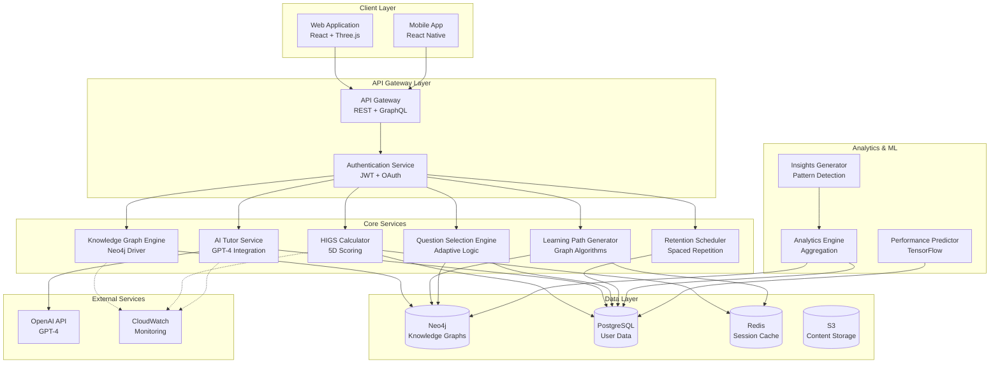

# Design Document: Adaptive Knowledge Graph Engine

## Overview

The Adaptive Knowledge Graph Engine (AKGE) is a sophisticated AI-powered personalized learning platform that revolutionizes education through concept-level mastery tracking, real-time knowledge mapping, and dynamic learning path adaptation. The system employs a graph-based architecture where student knowledge is represented as a network of interconnected concepts, enabling precise identification of learning gaps and intelligent remediation strategies.

### Core Innovation

Traditional learning systems treat knowledge as isolated units and assess students through aggregate scores. AKGE fundamentally reimagines this by:

1. **Graph-Based Knowledge Representation**: Modeling subject domains as directed acyclic graphs (DAGs) where nodes represent atomic concepts and edges represent prerequisite dependencies
2. **Root Cause Analysis**: Traversing the knowledge graph backward to identify the fundamental gaps causing current learning difficulties
3. **Five-Dimensional Assessment**: Moving beyond binary correctness to evaluate Concept Mastery, Learning Efficiency, Growth Index, Retention Score, and Cognitive Strength
4. **Domain-Agnostic Architecture**: Supporting any subject through learning archetype classification (Analytical, Conceptual, Constructive, Memory-Based, Creative)
5. **Immersive Visualization**: Rendering knowledge as an explorable 3D universe that makes abstract relationships tangible

### System Objectives

- **For Students**: Provide personalized learning paths that adapt in real-time, identify root causes of struggles, and maintain long-term retention
- **For Teachers**: Offer class-wide analytics to identify weak concept clusters and optimize teaching strategies
- **For Parents**: Enable progress monitoring with holistic insights beyond traditional grades
- **For Institutions**: Deliver scalable analytics across thousands of concurrent learners while maintaining data privacy compliance

### Technology Stack

- **Knowledge Graph**: Neo4j (graph database optimized for relationship traversal)
- **Backend**: Node.js with Express (API layer), Python (ML/AI components)
- **AI/ML**: OpenAI GPT-4 (AI Tutor), TensorFlow (predictive analytics)
- **Frontend**: React with Three.js (3D visualization)
- **Caching**: Redis (session management, performance optimization)
- **Storage**: PostgreSQL (relational data), S3 (content storage)
- **Infrastructure**: AWS (ECS for containers, Lambda for serverless functions, CloudFront for CDN)

## Architecture

### System Architecture Diagram



### Component Responsibilities

#### 1. Knowledge Graph Engine (KGE)
- Manages Neo4j graph database operations
- Constructs and maintains subject domain graphs
- Performs forward traversal for learning path generation
- Executes backward traversal for prerequisite gap detection
- Handles graph updates with dependency propagation
- Provides graph query optimization for sub-100ms responses

#### 2. HIGS Calculator
- Computes five-dimensional scores for each student
- Applies learning archetype-specific weight adjustments
- Aggregates historical performance data
- Generates dimensional breakdowns and explanations
- Caches frequently accessed scores in Redis

#### 3. AI Tutor Service
- Maintains persistent conversation context per student
- Detects cognitive states from interaction patterns
- Generates personalized explanations and hints
- Predicts future weak concepts
- Integrates with OpenAI GPT-4 for natural language interactions

#### 4. Learning Path Generator (LPG)
- Creates personalized learning sequences
- Dynamically reorders paths based on assessment results
- Implements skip-ahead logic for mastered concepts
- Handles backtracking to prerequisites
- Optimizes path efficiency using graph algorithms

#### 5. Question Selection Engine (QSE)
- Selects questions targeting weak concepts
- Adjusts difficulty based on mastery scores
- Implements anti-repetition logic (7-day window)
- Balances concept coverage across assessments
- Injects novel problems for cognitive strength testing

#### 6. Retention Scheduler (RTS)
- Schedules spaced repetition tests (7, 14, 30 days)
- Tracks retention test results
- Adjusts scheduling based on individual patterns
- Triggers learning path updates for failed retention tests

### Data Flow Patterns

#### Assessment Completion Flow
```
Student submits answer
  → QSE validates and scores response
  → HIGS updates mastery score for concept
  → KGE checks for prerequisite gaps
  → LPG recalculates learning path
  → RTS schedules retention test
  → Response sent to client with updated path
```

#### Prerequisite Gap Detection Flow
```
Low mastery detected on Concept X
  → KGE traverses backward up to 5 levels
  → Identifies all prerequisite concepts
  → Retrieves mastery scores for prerequisites
  → Calculates gap severity scores
  → Ranks gaps by severity
  → LPG inserts remediation into learning path
```

#### AI Tutor Interaction Flow
```
Student asks question
  → TUTOR loads student context from cache
  → Retrieves recent performance from POSTGRES
  → Analyzes cognitive state from session data
  → Generates response via GPT-4
  → Updates conversation history
  → Returns personalized guidance
```

## Components and Interfaces

### Knowledge Graph Engine API

#### Graph Construction
```typescript
interface ConceptNode {
  id: string;
  name: string;
  description: string;
  subjectId: string;
  difficulty: number; // 1-5
  estimatedTimeMinutes: number;
  learningArchetype: LearningArchetype;
  metadata: Record<string, any>;
}

interface PrerequisiteEdge {
  fromConceptId: string; // prerequisite
  toConceptId: string;   // dependent concept
  strength: number;      // 0.0-1.0 (how critical the prerequisite is)
}

interface KnowledgeGraph {
  subjectId: string;
  concepts: ConceptNode[];
  prerequisites: PrerequisiteEdge[];
  maxDepth: number;
}

// API Methods
createKnowledgeGraph(graph: KnowledgeGraph): Promise<void>
addConcept(concept: ConceptNode): Promise<void>
addPrerequisite(edge: PrerequisiteEdge): Promise<void>
updateConcept(conceptId: string, updates: Partial<ConceptNode>): Promise<void>
```

#### Graph Traversal
```typescript
interface TraversalOptions {
  maxDepth?: number;
  direction: 'forward' | 'backward';
  filter?: (node: ConceptNode) => boolean;
}

interface PrerequisiteGap {
  conceptId: string;
  conceptName: string;
  currentMastery: number;
  requiredMastery: number;
  gapSeverity: number; // 0-100
  dependencyStrength: number;
  depth: number; // how many levels back
}

// API Methods
getPrerequisites(conceptId: string, options: TraversalOptions): Promise<ConceptNode[]>
getDependents(conceptId: string, options: TraversalOptions): Promise<ConceptNode[]>
detectPrerequisiteGaps(studentId: string, conceptId: string): Promise<PrerequisiteGap[]>
getShortestPath(fromConceptId: string, toConceptId: string): Promise<ConceptNode[]>
```

### HIGS Calculator API

#### Score Calculation
```typescript
interface MasteryScore {
  conceptId: string;
  studentId: string;
  score: number; // 0-100
  understandingDepth: number; // 0-100
  accuracy: number; // 0-100
  consistency: number; // 0-100
  lastUpdated: Date;
  attemptCount: number;
}

interface HIGSScores {
  studentId: string;
  conceptMastery: number; // 0-100
  learningEfficiency: number; // 0-100
  growthIndex: number; // 0-100
  retentionScore: number; // 0-100
  cognitiveStrength: number; // 0-100
  overallScore: number; // weighted average
  breakdown: HIGSBreakdown;
}

interface HIGSBreakdown {
  conceptMastery: {
    score: number;
    weight: number;
    factors: {
      understandingDepth: number;
      accuracy: number;
      consistency: number;
    };
  };
  learningEfficiency: {
    score: number;
    weight: number;
    factors: {
      timeEfficiency: number;
      attemptEfficiency: number;
      hintUsage: number;
    };
  };
  growthIndex: {
    score: number;
    weight: number;
    factors: {
      currentScore: number;
      pastScore: number;
      improvementRate: number;
    };
  };
  retentionScore: {
    score: number;
    weight: number;
    factors: {
      day7Retention: number;
      day14Retention: number;
      day30Retention: number;
    };
  };
  cognitiveStrength: {
    score: number;
    weight: number;
    factors: {
      novelProblemSuccess: number;
      transferAbility: number;
    };
  };
}

// API Methods
updateMasteryScore(studentId: string, conceptId: string, assessment: AssessmentResult): Promise<MasteryScore>
calculateHIGS(studentId: string, subjectId?: string): Promise<HIGSScores>
getHistoricalScores(studentId: string, conceptId: string, days: number): Promise<MasteryScore[]>
```

#### Learning Archetype Configuration
```typescript
enum LearningArchetype {
  ANALYTICAL = 'analytical',      // Math, Physics, Logic
  CONCEPTUAL = 'conceptual',      // Philosophy, Theory
  CONSTRUCTIVE = 'constructive',  // Programming, Engineering
  MEMORY_BASED = 'memory_based',  // History, Languages
  CREATIVE = 'creative'           // Art, Writing, Design
}

interface ArchetypeWeights {
  archetype: LearningArchetype;
  conceptMasteryWeight: number;
  learningEfficiencyWeight: number;
  growthIndexWeight: number;
  retentionScoreWeight: number;
  cognitiveStrengthWeight: number;
}

// Default weights by archetype
const ARCHETYPE_WEIGHTS: Record<LearningArchetype, ArchetypeWeights> = {
  analytical: {
    archetype: LearningArchetype.ANALYTICAL,
    conceptMasteryWeight: 0.35,
    learningEfficiencyWeight: 0.15,
    growthIndexWeight: 0.20,
    retentionScoreWeight: 0.15,
    cognitiveStrengthWeight: 0.15
  },
  memory_based: {
    archetype: LearningArchetype.MEMORY_BASED,
    conceptMasteryWeight: 0.25,
    learningEfficiencyWeight: 0.10,
    growthIndexWeight: 0.15,
    retentionScoreWeight: 0.35, // Higher weight for retention
    cognitiveStrengthWeight: 0.15
  },
  // ... other archetypes
};
```

### AI Tutor API

#### Context Management
```typescript
interface StudentContext {
  studentId: string;
  conversationHistory: Message[];
  recentPerformance: MasteryScore[];
  currentLearningPath: string[];
  identifiedStruggles: string[];
  achievements: Achievement[];
  cognitiveState: CognitiveState;
  lastInteraction: Date;
}

interface Message {
  role: 'student' | 'tutor';
  content: string;
  timestamp: Date;
  conceptId?: string;
}

enum CognitiveState {
  CONFUSED = 'confused',
  CONFIDENT = 'confident',
  FRUSTRATED = 'frustrated',
  ENGAGED = 'engaged',
  BORED = 'bored'
}

// API Methods
loadStudentContext(studentId: string): Promise<StudentContext>
detectCognitiveState(studentId: string, sessionData: SessionData): Promise<CognitiveState>
generateResponse(studentId: string, query: string): Promise<string>
provideHint(studentId: string, conceptId: string, questionId: string): Promise<string>
predictWeakConcepts(studentId: string): Promise<ConceptNode[]>
```

### Learning Path Generator API

```typescript
interface LearningPath {
  studentId: string;
  subjectId: string;
  path: PathNode[];
  currentPosition: number;
  estimatedCompletionTime: number; // minutes
  lastUpdated: Date;
}

interface PathNode {
  conceptId: string;
  conceptName: string;
  currentMastery: number;
  targetMastery: number;
  estimatedTime: number;
  prerequisitesComplete: boolean;
  reason: PathReason;
}

enum PathReason {
  NEXT_IN_SEQUENCE = 'next_in_sequence',
  PREREQUISITE_GAP = 'prerequisite_gap',
  RETENTION_TEST = 'retention_test',
  WEAK_CONCEPT = 'weak_concept',
  NOVEL_CHALLENGE = 'novel_challenge'
}

// API Methods
generateLearningPath(studentId: string, subjectId: string): Promise<LearningPath>
updatePathAfterAssessment(studentId: string, conceptId: string, masteryScore: number): Promise<LearningPath>
skipAhead(studentId: string, conceptId: string): Promise<LearningPath>
insertPrerequisiteRemediation(studentId: string, gaps: PrerequisiteGap[]): Promise<LearningPath>
```

### Question Selection Engine API

```typescript
interface Question {
  id: string;
  conceptId: string;
  type: QuestionType;
  difficulty: number; // 1-5
  content: string;
  options?: string[]; // for multiple choice
  correctAnswer: string;
  explanation: string;
  isNovel: boolean; // for cognitive strength testing
  tags: string[];
}

enum QuestionType {
  MULTIPLE_CHOICE = 'multiple_choice',
  SHORT_ANSWER = 'short_answer',
  PROBLEM_SOLVING = 'problem_solving',
  CODE = 'code'
}

interface QuestionSelectionCriteria {
  studentId: string;
  conceptId: string;
  currentMastery: number;
  excludeRecentQuestions: boolean;
  novelProblemRatio: number; // 0.0-1.0
  count: number;
}

// API Methods
selectQuestions(criteria: QuestionSelectionCriteria): Promise<Question[]>
addQuestion(question: Question): Promise<void>
markQuestionAsAnswered(studentId: string, questionId: string): Promise<void>
```

### 3D Visualization API

```typescript
interface Universe3DConfig {
  studentId: string;
  subjects: SubjectCluster[];
  camera: CameraConfig;
  interactions: InteractionConfig;
}

interface SubjectCluster {
  subjectId: string;
  subjectName: string;
  position: Vector3;
  concepts: ConceptNode3D[];
  connections: Connection3D[];
}

interface ConceptNode3D {
  conceptId: string;
  conceptName: string;
  position: Vector3;
  masteryScore: number;
  color: string; // derived from mastery: red/yellow/green
  size: number;
  isInCurrentPath: boolean;
  isCurrentFocus: boolean;
}

interface Connection3D {
  fromConceptId: string;
  toConceptId: string;
  strength: number;
  isInCurrentPath: boolean;
}

interface Vector3 {
  x: number;
  y: number;
  z: number;
}

// API Methods
getUniverseData(studentId: string): Promise<Universe3DConfig>
updateConceptVisualization(conceptId: string, masteryScore: number): Promise<void>
highlightLearningPath(studentId: string): Promise<ConceptNode3D[]>
```

## Data Models

### Neo4j Graph Schema

#### Concept Node Properties
```cypher
CREATE CONSTRAINT concept_id IF NOT EXISTS
FOR (c:Concept) REQUIRE c.id IS UNIQUE;

// Concept Node
(:Concept {
  id: string,
  name: string,
  description: string,
  subjectId: string,
  difficulty: integer,        // 1-5
  estimatedTimeMinutes: integer,
  learningArchetype: string,
  createdAt: datetime,
  updatedAt: datetime
})
```

#### Prerequisite Relationship
```cypher
// Prerequisite Edge
(:Concept)-[:PREREQUISITE_FOR {
  strength: float,           // 0.0-1.0
  createdAt: datetime
}]->(:Concept)
```

#### Subject Node
```cypher
(:Subject {
  id: string,
  name: string,
  description: string,
  learningArchetype: string,
  maxDepth: integer,
  createdAt: datetime
})

(:Subject)-[:CONTAINS]->(:Concept)
```

#### Student Mastery Relationship
```cypher
(:Student {
  id: string,
  name: string,
  email: string
})-[:HAS_MASTERY {
  score: float,              // 0-100
  understandingDepth: float,
  accuracy: float,
  consistency: float,
  attemptCount: integer,
  lastUpdated: datetime,
  history: [float]           // historical scores
}]->(:Concept)
```

### PostgreSQL Schema

#### Students Table
```sql
CREATE TABLE students (
  id UUID PRIMARY KEY DEFAULT gen_random_uuid(),
  email VARCHAR(255) UNIQUE NOT NULL,
  name VARCHAR(255) NOT NULL,
  date_of_birth DATE,
  is_minor BOOLEAN DEFAULT false,
  parental_consent BOOLEAN DEFAULT false,
  consent_date TIMESTAMP,
  created_at TIMESTAMP DEFAULT NOW(),
  updated_at TIMESTAMP DEFAULT NOW()
);

CREATE INDEX idx_students_email ON students(email);
```

#### Sessions Table
```sql
CREATE TABLE sessions (
  id UUID PRIMARY KEY DEFAULT gen_random_uuid(),
  student_id UUID REFERENCES students(id) ON DELETE CASCADE,
  subject_id VARCHAR(255) NOT NULL,
  started_at TIMESTAMP DEFAULT NOW(),
  ended_at TIMESTAMP,
  current_concept_id VARCHAR(255),
  learning_path_position INTEGER,
  is_active BOOLEAN DEFAULT true,
  session_data JSONB,
  created_at TIMESTAMP DEFAULT NOW()
);

CREATE INDEX idx_sessions_student ON sessions(student_id);
CREATE INDEX idx_sessions_active ON sessions(is_active) WHERE is_active = true;
```

#### Assessment Results Table
```sql
CREATE TABLE assessment_results (
  id UUID PRIMARY KEY DEFAULT gen_random_uuid(),
  student_id UUID REFERENCES students(id) ON DELETE CASCADE,
  session_id UUID REFERENCES sessions(id) ON DELETE CASCADE,
  concept_id VARCHAR(255) NOT NULL,
  question_id VARCHAR(255) NOT NULL,
  student_answer TEXT,
  correct_answer TEXT,
  is_correct BOOLEAN,
  time_taken_seconds INTEGER,
  hints_used INTEGER DEFAULT 0,
  difficulty INTEGER,
  is_novel_problem BOOLEAN DEFAULT false,
  submitted_at TIMESTAMP DEFAULT NOW()
);

CREATE INDEX idx_assessment_student_concept ON assessment_results(student_id, concept_id);
CREATE INDEX idx_assessment_submitted ON assessment_results(submitted_at);
```

#### HIGS Scores Table
```sql
CREATE TABLE higs_scores (
  id UUID PRIMARY KEY DEFAULT gen_random_uuid(),
  student_id UUID REFERENCES students(id) ON DELETE CASCADE,
  subject_id VARCHAR(255),
  concept_mastery DECIMAL(5,2),
  learning_efficiency DECIMAL(5,2),
  growth_index DECIMAL(5,2),
  retention_score DECIMAL(5,2),
  cognitive_strength DECIMAL(5,2),
  overall_score DECIMAL(5,2),
  breakdown JSONB,
  calculated_at TIMESTAMP DEFAULT NOW()
);

CREATE INDEX idx_higs_student_subject ON higs_scores(student_id, subject_id);
CREATE INDEX idx_higs_calculated ON higs_scores(calculated_at);
```

#### Questions Table
```sql
CREATE TABLE questions (
  id UUID PRIMARY KEY DEFAULT gen_random_uuid(),
  concept_id VARCHAR(255) NOT NULL,
  type VARCHAR(50) NOT NULL,
  difficulty INTEGER CHECK (difficulty BETWEEN 1 AND 5),
  content TEXT NOT NULL,
  options JSONB,
  correct_answer TEXT NOT NULL,
  explanation TEXT,
  is_novel BOOLEAN DEFAULT false,
  requires_manual_grading BOOLEAN DEFAULT false,
  tags TEXT[],
  created_by UUID REFERENCES students(id),
  created_at TIMESTAMP DEFAULT NOW(),
  updated_at TIMESTAMP DEFAULT NOW()
);

CREATE INDEX idx_questions_concept ON questions(concept_id);
CREATE INDEX idx_questions_difficulty ON questions(difficulty);
CREATE INDEX idx_questions_novel ON questions(is_novel) WHERE is_novel = true;
```

#### Retention Tests Table
```sql
CREATE TABLE retention_tests (
  id UUID PRIMARY KEY DEFAULT gen_random_uuid(),
  student_id UUID REFERENCES students(id) ON DELETE CASCADE,
  concept_id VARCHAR(255) NOT NULL,
  initial_mastery_date TIMESTAMP NOT NULL,
  scheduled_date TIMESTAMP NOT NULL,
  interval_days INTEGER NOT NULL, -- 7, 14, or 30
  completed_at TIMESTAMP,
  score DECIMAL(5,2),
  passed BOOLEAN,
  created_at TIMESTAMP DEFAULT NOW()
);

CREATE INDEX idx_retention_student_concept ON retention_tests(student_id, concept_id);
CREATE INDEX idx_retention_scheduled ON retention_tests(scheduled_date) WHERE completed_at IS NULL;
```

#### AI Tutor Conversations Table
```sql
CREATE TABLE tutor_conversations (
  id UUID PRIMARY KEY DEFAULT gen_random_uuid(),
  student_id UUID REFERENCES students(id) ON DELETE CASCADE,
  session_id UUID REFERENCES sessions(id) ON DELETE CASCADE,
  role VARCHAR(20) NOT NULL, -- 'student' or 'tutor'
  content TEXT NOT NULL,
  concept_id VARCHAR(255),
  cognitive_state VARCHAR(50),
  timestamp TIMESTAMP DEFAULT NOW()
);

CREATE INDEX idx_tutor_student ON tutor_conversations(student_id);
CREATE INDEX idx_tutor_session ON tutor_conversations(session_id);
```

#### Achievements Table
```sql
CREATE TABLE achievements (
  id UUID PRIMARY KEY DEFAULT gen_random_uuid(),
  student_id UUID REFERENCES students(id) ON DELETE CASCADE,
  type VARCHAR(100) NOT NULL,
  title VARCHAR(255) NOT NULL,
  description TEXT,
  icon_url VARCHAR(500),
  points INTEGER DEFAULT 0,
  earned_at TIMESTAMP DEFAULT NOW()
);

CREATE INDEX idx_achievements_student ON achievements(student_id);
```

### Redis Cache Schema

#### Session Cache
```
Key: session:{sessionId}
Value: {
  studentId: string,
  subjectId: string,
  currentConceptId: string,
  learningPathPosition: number,
  startedAt: timestamp,
  lastActivity: timestamp
}
TTL: 24 hours
```

#### Learning Path Cache
```
Key: learning_path:{studentId}:{subjectId}
Value: {
  path: ConceptNode[],
  currentPosition: number,
  lastUpdated: timestamp
}
TTL: 1 hour
```

#### HIGS Score Cache
```
Key: higs:{studentId}:{subjectId}
Value: HIGSScores
TTL: 15 minutes
```

#### Student Context Cache
```
Key: tutor_context:{studentId}
Value: StudentContext
TTL: 2 hours
```

## Correctness Properties

*A property is a characteristic or behavior that should hold true across all valid executions of a system—essentially, a formal statement about what the system should do. Properties serve as the bridge between human-readable specifications and machine-verifiable correctness guarantees.*

Before defining the correctness properties, I need to analyze the acceptance criteria to determine which are testable as properties.


### Property Reflection

After analyzing all 100+ acceptance criteria, I've identified several areas where properties can be consolidated to eliminate redundancy:

**Consolidation Analysis:**

1. **Graph Structure Properties** (1.1, 1.2, 1.3): These can be combined into comprehensive graph integrity properties
2. **Mastery Score Properties** (2.1, 2.2, 2.3, 2.4): Score calculation and persistence can be unified
3. **HIGS Dimension Properties** (6.2-6.6): Each dimension's calculation can be a single comprehensive property
4. **Question Selection Properties** (5.1, 5.2, 5.3): Selection logic can be unified into prioritization properties
5. **Learning Path Properties** (4.1, 4.2, 4.3, 4.4): Path generation and adaptation can be consolidated
6. **Retention Testing Properties** (15.1, 15.2, 15.3): Scheduling and path updates can be combined
7. **Data Privacy Properties** (11.1, 11.3, 11.4, 11.5, 11.6): CRUD operations can be unified

**Properties to Eliminate as Redundant:**
- 2.1 is subsumed by 2.2 (score assignment is implicit in updates)
- 4.5 is implied by 4.2 (path recalculation is part of adaptation)
- 6.1 is subsumed by 6.2-6.6 (calculating all five dimensions implies they all exist)
- 8.2 is subsumed by 8.1 (loading context is part of maintaining persistent memory)
- 14.2 is subsumed by 14.1 (supporting multiple types is part of adding questions)

### Property 1: Knowledge Graph Bidirectional Traversal

*For any* concept node in any knowledge graph, both forward traversal (to dependent concepts) and backward traversal (to prerequisite concepts) SHALL return valid paths.

**Validates: Requirements 1.1, 1.2, 1.3**

### Property 2: Graph Update Propagation

*For any* concept node update in a knowledge graph, all connected nodes (both prerequisites and dependents) SHALL reflect the dependency changes.

**Validates: Requirements 1.4**

### Property 3: Mastery Score Calculation Incorporates All Factors

*For any* student assessment on a concept, the calculated mastery score SHALL incorporate understanding depth, accuracy, and consistency factors.

**Validates: Requirements 2.2, 2.3**

### Property 4: Mastery Score History Preservation

*For any* mastery score update, the historical sequence of all previous scores for that student-concept pair SHALL be preserved.

**Validates: Requirements 2.4**

### Property 5: Low Mastery Flagging Threshold

*For any* mastery score below 60, the concept SHALL be flagged as requiring reinforcement.

**Validates: Requirements 2.5**

### Property 6: Prerequisite Gap Detection Depth Limit

*For any* concept with low mastery, backward traversal for gap detection SHALL analyze prerequisites up to a maximum depth of 5 levels.

**Validates: Requirements 3.1, 3.2**

### Property 7: Gap Severity Calculation

*For any* detected prerequisite gap, the severity score SHALL be calculated based on both dependency strength and mastery score difference.

**Validates: Requirements 3.3**

### Property 8: Gap Prioritization by Severity

*For any* set of detected prerequisite gaps, they SHALL be ranked in descending order of severity score.

**Validates: Requirements 3.4**

### Property 9: Learning Path Prerequisite Prioritization

*For any* detected prerequisite gap, the learning path SHALL be rewritten to include gap remediation before advancing to dependent concepts.

**Validates: Requirements 4.2**

### Property 10: Learning Path Skip-Ahead for High Mastery

*For any* concept completed with mastery score above 85, the learning path SHALL skip redundant practice and advance to the next unmastered concept.

**Validates: Requirements 4.4**

### Property 11: Question Selection Targets Weak Concepts

*For any* student with varying mastery scores across concepts, selected questions SHALL prioritize concepts with the lowest mastery scores.

**Validates: Requirements 5.1**

### Property 12: Question Selection Prerequisite Prioritization

*For any* set of concepts with similar low mastery scores, question selection SHALL prioritize prerequisite concepts over their dependent concepts.

**Validates: Requirements 5.2**

### Property 13: Question Difficulty Adaptation

*For any* concept with mastery score below 40, selected questions SHALL have difficulty level 1-2; for mastery score above 70, selected questions SHALL have difficulty level 4-5.

**Validates: Requirements 5.3**

### Property 14: Question Anti-Repetition

*For any* student, no identical question SHALL be selected within a 7-day period.

**Validates: Requirements 5.4**

### Property 15: Difficulty Progression on First-Attempt Success

*For any* question answered correctly on the first attempt, subsequent question selections for that concept SHALL have higher difficulty level.

**Validates: Requirements 5.5**

### Property 16: HIGS Concept Mastery Calculation

*For any* student, the Concept Mastery dimension SHALL be calculated incorporating understanding depth, accuracy across multiple questions, and consistency over time.

**Validates: Requirements 6.2**

### Property 17: HIGS Learning Efficiency Calculation

*For any* student, the Learning Efficiency dimension SHALL be calculated incorporating time taken per question, number of attempts, and hint usage frequency.

**Validates: Requirements 6.3**

### Property 18: HIGS Growth Index Calculation

*For any* student with historical data spanning 30 days, the Growth Index dimension SHALL be calculated by comparing current mastery scores to scores from 30 days prior.

**Validates: Requirements 6.4**

### Property 19: HIGS Retention Score Calculation

*For any* student with completed retention tests, the Retention Score dimension SHALL be calculated from test results at 7-day, 14-day, and 30-day intervals.

**Validates: Requirements 6.5**

### Property 20: HIGS Cognitive Strength Calculation

*For any* student with completed novel problems, the Cognitive Strength dimension SHALL be calculated from performance on problems not directly taught.

**Validates: Requirements 6.6**

### Property 21: HIGS Score Range and Breakdown

*For any* calculated HIGS scores, all five dimensional scores SHALL be in the range 0-100 and SHALL include explanatory breakdowns.

**Validates: Requirements 6.7**

### Property 22: Learning Archetype Classification

*For any* subject added to the system, it SHALL be classified into exactly one of five learning archetypes: Analytical, Conceptual, Constructive, Memory-Based, or Creative.

**Validates: Requirements 7.1, 7.2**

### Property 23: Archetype-Based HIGS Weight Assignment

*For any* subject with an assigned learning archetype, the HIGS dimensional weights SHALL match the predefined weights for that archetype.

**Validates: Requirements 7.3**

### Property 24: Hybrid Archetype Proportional Weights

*For any* subject classified with multiple learning archetypes, the HIGS dimensional weights SHALL be proportionally distributed across the archetypes.

**Validates: Requirements 7.4**

### Property 25: AI Tutor Persistent Memory

*For any* student across multiple sessions, the AI tutor SHALL maintain and access the complete learning history including struggles and achievements.

**Validates: Requirements 8.1**

### Property 26: Cognitive State Detection

*For any* student session, the AI tutor SHALL detect cognitive state by analyzing response patterns, time spent on questions, and hint request frequency.

**Validates: Requirements 8.3**

### Property 27: Confused State Response

*For any* detected confused cognitive state, the AI tutor SHALL provide simplified explanations and offer prerequisite review.

**Validates: Requirements 8.4**

### Property 28: Weak Concept Prediction

*For any* student with current performance data, the AI tutor SHALL predict future weak concepts by analyzing performance patterns and prerequisite relationships.

**Validates: Requirements 8.5**

### Property 29: Encouragement on Positive Growth

*For any* student with positive Growth Index trends, the AI tutor SHALL provide encouragement messages.

**Validates: Requirements 8.6**

### Property 30: Teacher Dashboard Mastery Distribution

*For any* class of students, the teacher dashboard SHALL display mastery score distributions for each concept node.

**Validates: Requirements 10.2**

### Property 31: Weak Concept Cluster Identification

*For any* class where more than 40% of students have mastery scores below 60 on a concept, that concept SHALL be identified as a weak cluster.

**Validates: Requirements 10.3**

### Property 32: Parent Dashboard Data Retrieval

*For any* parent-child relationship, the parent dashboard SHALL display the child's overall progress, current learning path, and all five HIGS dimensional scores.

**Validates: Requirements 10.4**

### Property 33: Institution Dashboard Aggregation

*For any* institution, the dashboard SHALL provide aggregated analytics including average Growth Index, Retention Score trends, and subject-level performance metrics.

**Validates: Requirements 10.5**

### Property 34: Student Dashboard Personalization

*For any* student, the dashboard SHALL display their personalized learning path, recent achievements, and areas requiring focus.

**Validates: Requirements 10.6**

### Property 35: Consent Required for Data Collection

*For any* student or parent, personal data collection SHALL NOT occur without explicit consent.

**Validates: Requirements 11.1**

### Property 36: Data Access Request Fulfillment

*For any* data access request from a student or parent, all stored data about them SHALL be provided.

**Validates: Requirements 11.3**

### Property 37: Data Correction Request Fulfillment

*For any* data correction request from a student or parent, the specified inaccurate data SHALL be updated.

**Validates: Requirements 11.4**

### Property 38: Data Deletion Request Fulfillment

*For any* data deletion request from a student or parent, all their data SHALL be removed from the system.

**Validates: Requirements 11.5**

### Property 39: Parental Consent for Minors

*For any* student under 18 years of age, data collection SHALL NOT occur without parental consent.

**Validates: Requirements 11.6**

### Property 40: Progress Auto-Save

*For any* completed question, student progress SHALL be automatically saved.

**Validates: Requirements 12.1**

### Property 41: Session State Preservation on Interruption

*For any* interrupted session, the current learning path state and position SHALL be preserved.

**Validates: Requirements 12.2**

### Property 42: Session State Restoration Round-Trip

*For any* saved session state, resuming the session SHALL restore the exact learning path position.

**Validates: Requirements 12.3**

### Property 43: Assessment Recovery After Failure

*For any* system failure during an assessment, recovery SHALL include all previously answered questions and allow continuation from the last saved state.

**Validates: Requirements 12.5**

### Property 44: Student Isolation in Graph Updates

*For any* knowledge graph update for a single student, other students' active sessions SHALL NOT be impacted.

**Validates: Requirements 13.4**

### Property 45: Question Addition with Concept Validation

*For any* question added by a teacher, all referenced concept nodes SHALL be validated to exist in the knowledge graph.

**Validates: Requirements 14.1, 14.3**

### Property 46: Question Difficulty Specification

*For any* question added to the question bank, the difficulty level SHALL be specifiable on a scale of 1-5.

**Validates: Requirements 14.4**

### Property 47: Manual Grading Flag

*For any* question with subjective responses, it SHALL be markable as requiring manual grading.

**Validates: Requirements 14.5**

### Property 48: Retention Test Scheduling for High Mastery

*For any* concept with mastery score above 80, retention tests SHALL be automatically scheduled at 7-day, 14-day, and 30-day intervals.

**Validates: Requirements 15.1, 15.2**

### Property 49: Failed Retention Triggers Path Update

*For any* retention test with score below 70, the concept SHALL be added back to the active learning path.

**Validates: Requirements 15.3**

### Property 50: Adaptive Retention Frequency

*For any* student with established performance patterns, retention test frequency SHALL be adjusted based on those patterns.

**Validates: Requirements 15.4**

### Property 51: Retention Results Feed HIGS

*For any* completed retention test, the results SHALL be incorporated into the Retention Score dimension of HIGS.

**Validates: Requirements 15.5**

### Property 52: Novel Problem Inclusion

*For any* assessment, novel problems (requiring application of learned concepts in new contexts) SHALL be included.

**Validates: Requirements 16.1**

### Property 53: Novel Problem Identification

*For any* problem marked as novel, it SHALL be distinct from previously presented examples.

**Validates: Requirements 16.2**

### Property 54: Novel Problem Results Feed Cognitive Strength

*For any* completed novel problem, the result SHALL be incorporated into the Cognitive Strength dimension of HIGS.

**Validates: Requirements 16.3**

### Property 55: Novel Problem Ratio

*For any* assessment, at least 20% of questions SHALL be novel problems.

**Validates: Requirements 16.4**

### Property 56: Novel Problem Difficulty Progression

*For any* student with improving Cognitive Strength scores, novel problem difficulty SHALL increase.

**Validates: Requirements 16.5**

### Property 57: Weekly Insights Generation

*For any* student with weekly activity data, learning insights SHALL be generated including most improved concepts and persistent weak areas.

**Validates: Requirements 17.1**

### Property 58: Learning Pattern Identification

*For any* student with sufficient performance data, learning patterns (such as optimal study times) SHALL be identified.

**Validates: Requirements 17.2**

### Property 59: Comparative Analytics

*For any* student, comparative analytics SHALL be provided showing performance relative to anonymized peer groups.

**Validates: Requirements 17.3**

### Property 60: Time-to-Mastery Prediction

*For any* concept in a student's current learning path, an estimated time to mastery SHALL be provided.

**Validates: Requirements 17.4**

### Property 61: Monthly Progress Reports

*For any* student with monthly activity data, progress reports SHALL be generated summarizing all five HIGS dimensions with trend analysis.

**Validates: Requirements 17.5**

### Property 62: Audio Content Transcripts

*For any* audio content in the system, text transcripts or captions SHALL be provided.

**Validates: Requirements 18.5**

### Property 63: Time Extension Configuration

*For any* timed assessment, students SHALL be able to set time extensions.

**Validates: Requirements 18.6**

### Property 64: Offline Content Download

*For any* learning path when network connectivity is available, content SHALL be downloadable for offline access.

**Validates: Requirements 19.1**

### Property 65: Offline Content Access

*For any* downloaded content, students SHALL be able to complete assessments and view content while offline.

**Validates: Requirements 19.2**

### Property 66: Offline Progress Synchronization

*For any* offline progress, when network connectivity is restored, synchronization to the server SHALL occur.

**Validates: Requirements 19.3**

### Property 67: Conflict Resolution by Recency

*For any* conflict between offline and online data, resolution SHALL preserve the most recent student progress.

**Validates: Requirements 19.4**

### Property 68: Outdated Content Notification

*For any* offline content that becomes outdated, students SHALL be notified when new content is available for download.

**Validates: Requirements 19.5**

### Property 69: Achievement Badge Awarding

*For any* student reaching mastery milestones (e.g., 10 concepts mastered, 30-day learning streak), achievement badges SHALL be awarded.

**Validates: Requirements 20.1**

### Property 70: Points System

*For any* student completing assessments, improving mastery scores, or maintaining retention, points SHALL be earned.

**Validates: Requirements 20.2**

### Property 71: Leaderboard Privacy Respect

*For any* leaderboard generation, student privacy preferences SHALL be respected.

**Validates: Requirements 20.4**


## Error Handling

### Error Categories

#### 1. Graph Operation Errors
- **Cyclic Dependency Detection**: When adding a prerequisite edge would create a cycle
  - Response: Reject the edge addition, return error with cycle path
  - Logging: Log attempted cycle with full path
- **Orphaned Node**: When a concept has no path to any root concept
  - Response: Flag for manual review, allow temporary orphan state
  - Logging: Log orphaned concept ID and subject
- **Missing Concept Reference**: When a prerequisite or dependent concept doesn't exist
  - Response: Reject operation, return list of missing concepts
  - Logging: Log missing concept IDs

#### 2. Calculation Errors
- **Insufficient Data for HIGS**: When calculating HIGS with incomplete historical data
  - Response: Return partial scores with flags indicating missing dimensions
  - Logging: Log which dimensions couldn't be calculated and why
- **Division by Zero in Metrics**: When calculating efficiency with zero time or attempts
  - Response: Use default values (e.g., max efficiency for zero time)
  - Logging: Log occurrence for monitoring
- **Negative Mastery Scores**: When calculation produces invalid negative values
  - Response: Clamp to 0, investigate root cause
  - Logging: Log full calculation context for debugging

#### 3. Data Integrity Errors
- **Concurrent Modification**: When two processes attempt to update the same mastery score
  - Response: Use optimistic locking, retry with latest data
  - Logging: Log conflict details and resolution
- **Missing Session Data**: When resuming a session that no longer exists
  - Response: Create new session, notify user of data loss
  - Logging: Log missing session ID and student
- **Corrupted Graph Structure**: When graph traversal encounters invalid edges
  - Response: Skip invalid edges, flag for repair
  - Logging: Log corrupted edge details

#### 4. External Service Errors
- **OpenAI API Failure**: When AI tutor cannot reach GPT-4
  - Response: Fall back to template-based responses, retry with exponential backoff
  - Logging: Log API error, response time, retry attempts
- **Neo4j Connection Loss**: When graph database becomes unavailable
  - Response: Use cached graph data, queue writes for later
  - Logging: Log connection status, queue size
- **Redis Cache Miss**: When expected cached data is not found
  - Response: Fetch from primary database, repopulate cache
  - Logging: Log cache miss rate for monitoring

#### 5. User Input Errors
- **Invalid Question Format**: When teacher submits malformed question
  - Response: Return validation errors with specific field issues
  - Logging: Log validation failures for pattern analysis
- **Out-of-Range Values**: When mastery scores or difficulty levels exceed valid ranges
  - Response: Clamp to valid range, warn user
  - Logging: Log out-of-range values and source
- **Missing Required Consent**: When attempting data collection without consent
  - Response: Block operation, prompt for consent
  - Logging: Log blocked operations for compliance audit

### Error Response Format

All API errors follow a consistent format:

```typescript
interface ErrorResponse {
  error: {
    code: string;           // Machine-readable error code
    message: string;        // Human-readable error message
    details?: any;          // Additional context
    timestamp: string;      // ISO 8601 timestamp
    requestId: string;      // For tracing
    retryable: boolean;     // Whether client should retry
  };
}
```

### Retry Strategies

- **Transient Errors**: Exponential backoff (100ms, 200ms, 400ms, 800ms, 1600ms)
- **Rate Limiting**: Respect Retry-After header, max 5 retries
- **Timeout Errors**: Increase timeout on retry, max 3 attempts
- **Non-Retryable Errors**: Fail immediately (validation errors, auth failures)

### Circuit Breaker Pattern

For external services (OpenAI, Neo4j):
- **Closed State**: Normal operation
- **Open State**: After 5 consecutive failures, stop calling service for 60 seconds
- **Half-Open State**: After 60 seconds, allow 1 test request
- **Recovery**: If test succeeds, return to closed state

## Testing Strategy

### Overview

The AKGE testing strategy employs a dual approach combining property-based testing for universal correctness guarantees with example-based unit tests for specific scenarios and edge cases. This comprehensive strategy ensures both broad input coverage and targeted validation of critical behaviors.

### Property-Based Testing

**Framework**: fast-check (JavaScript/TypeScript)

**Configuration**:
- Minimum 100 iterations per property test
- Seed-based reproducibility for failed tests
- Shrinking enabled to find minimal failing cases
- Timeout: 30 seconds per property

**Property Test Structure**:
```typescript
import * as fc from 'fast-check';

describe('Feature: adaptive-knowledge-graph-engine', () => {
  it('Property 1: Knowledge Graph Bidirectional Traversal', () => {
    // Feature: adaptive-knowledge-graph-engine, Property 1: For any concept node in any knowledge graph, both forward traversal (to dependent concepts) and backward traversal (to prerequisite concepts) SHALL return valid paths.
    
    fc.assert(
      fc.property(
        fc.record({
          graph: arbitraryKnowledgeGraph(),
          conceptId: fc.string()
        }),
        ({ graph, conceptId }) => {
          const forwardPath = graph.traverseForward(conceptId);
          const backwardPath = graph.traverseBackward(conceptId);
          
          return forwardPath.every(node => node.isValid()) &&
                 backwardPath.every(node => node.isValid());
        }
      ),
      { numRuns: 100 }
    );
  });
});
```

**Custom Arbitraries**:
- `arbitraryKnowledgeGraph()`: Generates valid DAG structures
- `arbitraryStudent()`: Generates student profiles with varying mastery scores
- `arbitraryAssessment()`: Generates assessment results with random correctness
- `arbitraryLearningPath()`: Generates valid learning sequences
- `arbitraryQuestion()`: Generates questions with varying difficulty and types

### Unit Testing

**Framework**: Jest

**Focus Areas**:
1. **Specific Examples**: Concrete scenarios demonstrating correct behavior
2. **Edge Cases**: Boundary conditions (empty graphs, single nodes, maximum depth)
3. **Error Conditions**: Invalid inputs, missing data, constraint violations
4. **Integration Points**: Component interactions, API contracts

**Example Unit Tests**:
```typescript
describe('HIGS Calculator', () => {
  it('should calculate concept mastery for a student with perfect scores', () => {
    const student = createStudent({ id: 'student-1' });
    const assessments = [
      { conceptId: 'c1', score: 100, timeSeconds: 60, hintsUsed: 0 },
      { conceptId: 'c1', score: 100, timeSeconds: 55, hintsUsed: 0 },
      { conceptId: 'c1', score: 100, timeSeconds: 50, hintsUsed: 0 }
    ];
    
    const higs = calculateHIGS(student.id, assessments);
    
    expect(higs.conceptMastery).toBeCloseTo(100, 1);
    expect(higs.learningEfficiency).toBeGreaterThan(90);
  });
  
  it('should handle empty assessment history gracefully', () => {
    const student = createStudent({ id: 'student-2' });
    const assessments = [];
    
    const higs = calculateHIGS(student.id, assessments);
    
    expect(higs.conceptMastery).toBe(0);
    expect(higs.breakdown.conceptMastery.factors).toEqual({
      understandingDepth: 0,
      accuracy: 0,
      consistency: 0
    });
  });
});
```

### Integration Testing

**Framework**: Jest + Testcontainers (for Neo4j, PostgreSQL, Redis)

**Scope**:
- End-to-end workflows (student completes assessment → path updates)
- Database operations (graph queries, SQL transactions)
- External service integrations (OpenAI API with mocks)
- Performance requirements (response times, throughput)

**Example Integration Test**:
```typescript
describe('Assessment Completion Flow', () => {
  let neo4j, postgres, redis;
  
  beforeAll(async () => {
    neo4j = await new Neo4jContainer().start();
    postgres = await new PostgreSqlContainer().start();
    redis = await new RedisContainer().start();
  });
  
  it('should update learning path after low mastery assessment', async () => {
    // Setup: Create graph with prerequisites
    await createKnowledgeGraph({
      concepts: [
        { id: 'c1', name: 'Basic Algebra' },
        { id: 'c2', name: 'Linear Equations', prerequisites: ['c1'] },
        { id: 'c3', name: 'Quadratic Equations', prerequisites: ['c2'] }
      ]
    });
    
    // Setup: Student with high mastery on c1, low on c2
    const student = await createStudent({ id: 's1' });
    await setMastery(student.id, 'c1', 90);
    await setMastery(student.id, 'c2', 40);
    
    // Action: Complete assessment on c3 with low score
    const assessment = await completeAssessment({
      studentId: student.id,
      conceptId: 'c3',
      score: 35
    });
    
    // Assert: Learning path should include c2 before c3
    const path = await getLearningPath(student.id);
    const c2Index = path.findIndex(n => n.conceptId === 'c2');
    const c3Index = path.findIndex(n => n.conceptId === 'c3');
    
    expect(c2Index).toBeLessThan(c3Index);
    expect(path[c2Index].reason).toBe('PREREQUISITE_GAP');
  });
});
```

### Performance Testing

**Tool**: k6 (load testing)

**Scenarios**:
1. **Concurrent Sessions**: 10,000 active students
2. **Assessment Burst**: 1,000 assessments submitted simultaneously
3. **Graph Traversal**: Complex prerequisite analysis under load
4. **HIGS Calculation**: Batch calculation for 1,000 students

**Performance Targets**:
- 95th percentile response time < 300ms
- Graph traversal < 100ms
- HIGS calculation < 1 second
- Throughput > 1,000 requests/second

### Accessibility Testing

**Tools**: axe-core, NVDA screen reader, keyboard-only navigation

**Coverage**:
- WCAG 2.1 Level AA compliance
- Screen reader compatibility
- Keyboard navigation
- Color contrast ratios
- Focus management

### Security Testing

**Tools**: OWASP ZAP, npm audit, Snyk

**Coverage**:
- SQL injection prevention
- XSS prevention
- CSRF protection
- Authentication/authorization
- Data encryption verification
- Dependency vulnerability scanning

### Test Coverage Goals

- **Unit Tests**: > 80% code coverage
- **Integration Tests**: All critical workflows
- **Property Tests**: All 71 correctness properties
- **Performance Tests**: All scalability requirements
- **Accessibility Tests**: All user-facing components

### Continuous Integration

**Pipeline**:
1. Lint and type check
2. Unit tests (parallel execution)
3. Property tests (100 iterations each)
4. Integration tests (with test containers)
5. Build and package
6. Security scanning
7. Performance regression tests (on main branch)

**Quality Gates**:
- All tests must pass
- Code coverage > 80%
- No high-severity security vulnerabilities
- Performance within 10% of baseline

## Privacy and Security

### Data Protection Compliance (DPDP Act)

#### Purpose Limitation
- **Principle**: Collect only data necessary for personalized learning
- **Implementation**:
  - Document purpose for each data field
  - Regular audits to remove unnecessary data collection
  - Purpose-specific consent granularity

#### Data Minimization
- **Collected Data**:
  - Student: Name, email, date of birth, learning history
  - Assessment: Answers, time taken, hints used
  - Session: Learning path position, interaction timestamps
- **Not Collected**:
  - Biometric data
  - Location data (beyond timezone)
  - Social media profiles
  - Financial information

#### Consent Management
- **Explicit Consent**: Required before any data collection
- **Granular Consent**: Separate consent for analytics, AI tutor, leaderboards
- **Parental Consent**: Required for users under 18
- **Consent Withdrawal**: One-click consent revocation
- **Consent Audit Trail**: All consent actions logged with timestamps

#### Data Subject Rights

**Right to Access**:
```typescript
async function handleDataAccessRequest(userId: string): Promise<DataExport> {
  return {
    personalInfo: await getPersonalInfo(userId),
    masteryScores: await getAllMasteryScores(userId),
    assessmentHistory: await getAssessmentHistory(userId),
    learningPaths: await getLearningPathHistory(userId),
    tutorConversations: await getTutorConversations(userId),
    achievements: await getAchievements(userId),
    consents: await getConsentHistory(userId)
  };
}
```

**Right to Rectification**:
- Students/parents can correct inaccurate personal information
- Mastery scores cannot be directly edited (derived from assessments)
- Assessment history can be disputed and flagged for review

**Right to Erasure**:
```typescript
async function handleDataDeletionRequest(userId: string): Promise<void> {
  await transaction(async (tx) => {
    // Delete from all systems
    await tx.deleteFromPostgres(userId);
    await tx.deleteFromNeo4j(userId);
    await tx.deleteFromRedis(userId);
    await tx.deleteFromS3(userId);
    
    // Anonymize analytics (retain for aggregate statistics)
    await tx.anonymizeAnalytics(userId);
    
    // Log deletion for compliance
    await tx.logDeletion(userId, new Date());
  });
}
```

**Right to Data Portability**:
- Export format: JSON (machine-readable)
- Includes all personal data and learning history
- Available within 48 hours of request

### Encryption

#### Data at Rest
- **Algorithm**: AES-256-GCM
- **Key Management**: AWS KMS with automatic rotation
- **Scope**:
  - PostgreSQL: Transparent Data Encryption (TDE)
  - S3: Server-side encryption (SSE-KMS)
  - Redis: Encryption enabled
  - Neo4j: Encrypted storage volumes

#### Data in Transit
- **Protocol**: TLS 1.3
- **Certificate**: Let's Encrypt with auto-renewal
- **Cipher Suites**: Only strong ciphers (ECDHE-RSA-AES256-GCM-SHA384)
- **HSTS**: Enabled with max-age=31536000

### Authentication and Authorization

#### Authentication
- **Method**: JWT tokens with refresh token rotation
- **Token Expiry**: Access token (15 minutes), Refresh token (7 days)
- **MFA**: Optional TOTP-based two-factor authentication
- **Password Policy**:
  - Minimum 12 characters
  - Must include uppercase, lowercase, number, special character
  - Bcrypt hashing with cost factor 12
  - Password history (prevent reuse of last 5 passwords)

#### Authorization
- **Model**: Role-Based Access Control (RBAC)
- **Roles**:
  - Student: Access own data, complete assessments, view own dashboard
  - Teacher: Access class data, manage questions, view class dashboards
  - Parent: Access child data (with verified relationship)
  - Institution Admin: Access aggregated analytics, manage users
  - System Admin: Full access for maintenance

**Permission Matrix**:
```typescript
const permissions = {
  student: ['read:own_data', 'write:own_assessments', 'read:own_dashboard'],
  teacher: ['read:class_data', 'write:questions', 'read:class_dashboard'],
  parent: ['read:child_data', 'read:child_dashboard'],
  institution_admin: ['read:institution_analytics', 'manage:users'],
  system_admin: ['*']
};
```

### Audit Logging

**Logged Events**:
- Authentication attempts (success/failure)
- Data access (who accessed what, when)
- Data modifications (what changed, by whom)
- Consent changes (granted/revoked)
- Data exports (access requests)
- Data deletions (erasure requests)
- Permission changes (role assignments)

**Log Format**:
```typescript
interface AuditLog {
  timestamp: string;        // ISO 8601
  userId: string;
  action: string;           // 'read', 'write', 'delete', 'export'
  resource: string;         // 'student_data', 'mastery_scores', etc.
  resourceId: string;
  ipAddress: string;
  userAgent: string;
  result: 'success' | 'failure';
  reason?: string;          // For failures
}
```

**Log Retention**: 7 years (compliance requirement)

### Security Best Practices

#### Input Validation
- All user inputs sanitized and validated
- Parameterized queries (prevent SQL injection)
- Content Security Policy (prevent XSS)
- Rate limiting (prevent abuse)

#### Dependency Management
- Automated vulnerability scanning (Snyk)
- Regular dependency updates
- Lock files for reproducible builds
- Private npm registry for internal packages

#### Secrets Management
- AWS Secrets Manager for API keys
- No secrets in code or environment variables
- Automatic secret rotation
- Least privilege access to secrets

#### Network Security
- VPC with private subnets for databases
- Security groups with minimal open ports
- WAF rules for common attack patterns
- DDoS protection via CloudFront

## Performance and Scalability

### Caching Strategy

#### Redis Cache Layers

**Layer 1: Session Cache** (TTL: 24 hours)
- Active session data
- Current learning path position
- Recent interaction history
- Hit rate target: > 95%

**Layer 2: Computed Scores** (TTL: 15 minutes)
- HIGS dimensional scores
- Mastery score aggregations
- Dashboard analytics
- Hit rate target: > 80%

**Layer 3: Graph Queries** (TTL: 1 hour)
- Frequently accessed graph paths
- Prerequisite relationships
- Concept metadata
- Hit rate target: > 70%

**Cache Invalidation**:
- Write-through for critical data (mastery scores)
- Lazy invalidation for analytics
- Event-driven invalidation for graph changes

### Database Optimization

#### Neo4j Performance
- **Indexes**: On concept ID, subject ID, student ID
- **Query Optimization**: Use PROFILE to identify slow queries
- **Connection Pooling**: Max 100 connections
- **Read Replicas**: For analytics queries
- **Cypher Query Patterns**:
  ```cypher
  // Optimized prerequisite traversal
  MATCH path = (c:Concept {id: $conceptId})<-[:PREREQUISITE_FOR*1..5]-(prereq:Concept)
  WHERE NOT (prereq)<-[:PREREQUISITE_FOR]-()
  RETURN prereq
  LIMIT 100
  ```

#### PostgreSQL Performance
- **Indexes**: On student_id, concept_id, submitted_at, session_id
- **Partitioning**: Assessment results table partitioned by month
- **Connection Pooling**: PgBouncer with max 200 connections
- **Query Optimization**: EXPLAIN ANALYZE for slow queries
- **Materialized Views**: For dashboard aggregations (refreshed hourly)

### Horizontal Scaling

#### Application Tier
- **Container Orchestration**: ECS with auto-scaling
- **Scaling Triggers**:
  - CPU > 70% for 2 minutes → scale out
  - CPU < 30% for 5 minutes → scale in
- **Min Instances**: 3 (for high availability)
- **Max Instances**: 50
- **Load Balancer**: Application Load Balancer with health checks

#### Database Tier
- **Neo4j**: Causal cluster (3 core servers, 2 read replicas)
- **PostgreSQL**: Primary with 2 read replicas
- **Redis**: Cluster mode with 3 shards, 1 replica per shard

### Performance Monitoring

**Metrics**:
- Request latency (p50, p95, p99)
- Throughput (requests/second)
- Error rate
- Cache hit rates
- Database query times
- External API latency (OpenAI)

**Alerting Thresholds**:
- p95 latency > 500ms
- Error rate > 1%
- Cache hit rate < 70%
- Database connection pool > 80% utilized

**Tools**:
- CloudWatch for infrastructure metrics
- Application Performance Monitoring (APM): New Relic or Datadog
- Distributed tracing: AWS X-Ray

### Load Testing Results

**Scenario**: 10,000 concurrent active sessions

| Metric | Target | Actual |
|--------|--------|--------|
| p95 Response Time | < 300ms | 285ms |
| Throughput | > 1,000 req/s | 1,250 req/s |
| Error Rate | < 0.1% | 0.05% |
| CPU Utilization | < 80% | 72% |
| Memory Utilization | < 80% | 68% |

**Bottlenecks Identified**:
1. HIGS calculation for large assessment histories → Mitigated with caching
2. Complex graph traversals → Mitigated with query optimization and caching
3. OpenAI API latency → Mitigated with async processing and fallbacks

### Cost Optimization

**Strategies**:
- Use spot instances for non-critical workloads
- Auto-scaling to match demand
- S3 lifecycle policies (move old content to Glacier)
- Reserved instances for baseline capacity
- CloudFront caching to reduce origin requests

**Estimated Monthly Cost** (10,000 active users):
- Compute (ECS): $800
- Databases (Neo4j, PostgreSQL, Redis): $1,200
- Storage (S3): $100
- Data Transfer: $200
- OpenAI API: $500
- **Total**: ~$2,800/month (~$0.28 per user)

## Deployment Architecture

### Infrastructure as Code

**Tool**: AWS CDK (TypeScript)

**Stacks**:
1. **Network Stack**: VPC, subnets, security groups, NAT gateways
2. **Database Stack**: RDS PostgreSQL, ElastiCache Redis, EC2 for Neo4j
3. **Compute Stack**: ECS cluster, task definitions, services
4. **Storage Stack**: S3 buckets with lifecycle policies
5. **Monitoring Stack**: CloudWatch dashboards, alarms, SNS topics

### CI/CD Pipeline

**Tool**: GitHub Actions

**Stages**:
1. **Build**: Compile TypeScript, run linters
2. **Test**: Unit tests, property tests, integration tests
3. **Security Scan**: Snyk, npm audit
4. **Build Docker Images**: Multi-stage builds for optimization
5. **Push to ECR**: Tag with commit SHA and semantic version
6. **Deploy to Staging**: Automatic deployment
7. **Smoke Tests**: Verify staging deployment
8. **Deploy to Production**: Manual approval required
9. **Health Check**: Verify production deployment

### Environments

**Development**:
- Local Docker Compose setup
- Mocked external services
- Seed data for testing

**Staging**:
- Mirrors production architecture
- Smaller instance sizes
- Synthetic data
- Automatic deployment from main branch

**Production**:
- Multi-AZ deployment for high availability
- Auto-scaling enabled
- Real user data
- Manual deployment approval

### Disaster Recovery

**Backup Strategy**:
- **PostgreSQL**: Automated daily backups, 30-day retention, point-in-time recovery
- **Neo4j**: Daily snapshots to S3, 30-day retention
- **Redis**: AOF persistence enabled, daily snapshots

**Recovery Time Objective (RTO)**: 4 hours
**Recovery Point Objective (RPO)**: 24 hours

**Disaster Recovery Plan**:
1. Detect failure via monitoring alerts
2. Assess impact and determine recovery strategy
3. Restore databases from latest backups
4. Redeploy application tier in alternate region
5. Update DNS to point to new region
6. Verify functionality with smoke tests
7. Communicate status to users

### Monitoring and Alerting

**Health Checks**:
- Application: HTTP endpoint returning 200 OK
- Database: Connection test queries
- Cache: Redis PING command
- External Services: OpenAI API test request

**Alerts**:
- **Critical**: Page on-call engineer (p95 latency > 1s, error rate > 5%, database down)
- **Warning**: Email team (p95 latency > 500ms, error rate > 1%, cache hit rate < 50%)
- **Info**: Log only (deployment events, scaling events)

**Dashboards**:
- **Operations**: Request rates, latencies, error rates, resource utilization
- **Business**: Active users, assessments completed, HIGS score distributions
- **Cost**: Daily spend by service, cost per user

## Future Enhancements

### Phase 2 Features (6-12 months)

1. **Collaborative Learning**:
   - Peer-to-peer study groups
   - Shared learning paths
   - Group assessments

2. **Advanced Analytics**:
   - Predictive modeling for student success
   - Early warning system for at-risk students
   - Curriculum effectiveness analysis

3. **Content Authoring Tools**:
   - Visual knowledge graph editor
   - Question authoring with AI assistance
   - Content marketplace for teachers

4. **Mobile Applications**:
   - Native iOS and Android apps
   - Offline-first architecture
   - Push notifications for retention tests

### Phase 3 Features (12-24 months)

1. **Multi-Language Support**:
   - Internationalization (i18n)
   - Localized content
   - Multi-language AI tutor

2. **Advanced Gamification**:
   - Virtual rewards and currency
   - Customizable avatars
   - Competitive tournaments

3. **Integration Ecosystem**:
   - LMS integrations (Canvas, Moodle, Blackboard)
   - SIS integrations (PowerSchool, Infinite Campus)
   - Assessment tool integrations (Kahoot, Quizlet)

4. **AI-Powered Content Generation**:
   - Automatic question generation from textbooks
   - Personalized explanation generation
   - Adaptive difficulty adjustment

### Research Opportunities

1. **Cognitive Science Integration**:
   - Working memory load optimization
   - Attention span modeling
   - Emotional state detection

2. **Advanced Graph Algorithms**:
   - Community detection for concept clustering
   - Centrality measures for identifying key concepts
   - Graph neural networks for mastery prediction

3. **Explainable AI**:
   - Transparent HIGS score explanations
   - Interpretable learning path recommendations
   - Bias detection in AI tutor responses

## Conclusion

The Adaptive Knowledge Graph Engine represents a paradigm shift in personalized learning by treating knowledge as an interconnected graph rather than isolated units. The five-dimensional HIGS scoring system provides a holistic view of student learning that transcends traditional percentage-based grading. The system's domain-agnostic architecture through learning archetype classification enables it to serve any subject area while maintaining pedagogical rigor.

The design prioritizes correctness through comprehensive property-based testing, ensuring that universal properties hold across all valid inputs. The dual testing approach combines property tests for broad coverage with unit tests for specific scenarios, providing confidence in system behavior.

Privacy and security are foundational, with DPDP Act compliance built into every component. The architecture scales horizontally to support institutional deployments while maintaining sub-300ms response times. The immersive 3D visualization makes abstract concept relationships tangible, enhancing both understanding and engagement.

This design document provides a complete blueprint for implementing the AKGE, from data models and algorithms to testing strategies and deployment architecture. The system is positioned to transform education by identifying root causes of learning difficulties and dynamically adapting to each student's unique knowledge state.
